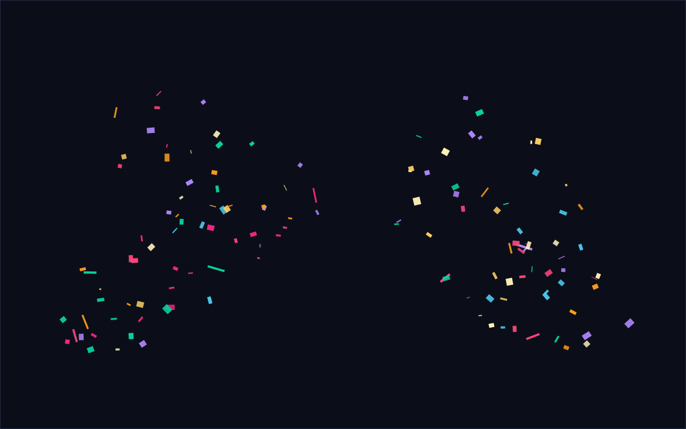

# dsh-confetti

English | [中文](README.zh.md)

**Every time a conversation finishes a turn, a party popper fires from each bottom corner of the window — and a 🎉 button beside the composer fires one on demand.**

A Web client plugin for DeepSeek Harness (DSH): a client-only effect, no Host services, no build step, no tools registered.



> The image is a captured frame (0.4 s) from the headless simulation — the real engine's canvas draw calls replayed — not a UI screenshot.

## Features

- **Automatic** — when a session's last step lands (`running` flips `true → false`), both bottom corners fire: the confetti arcs toward the center, tumbles, falls, fades, and the canvas recycles itself.
- **Manual** — a 🎉 in the composer's right-hand tool row, immediately left of Send. One press, one burst; press it as often as you like, it is not subject to the automatic celebration's cooldown.
- **Light** — `requestAnimationFrame` runs only while confetti is in the air; otherwise the plugin costs nothing. At most 640 pieces, recycled the moment they leave the frame, and the loop stops itself when the queue empties.
- **Unobtrusive** — delegated subagent sessions are skipped, backgrounded tabs do not replay a missed celebration, and `prefers-reduced-motion` is honored (one small puff, no second wave).
- **No footprint** — no new panel and no persistent UI; the only seat it takes is the composer tool slot the shell already allocates.

## Install

Prerequisites: a running DSH (the desktop app, or `dsh web`) and a profile. `desktop` is used below; `$env:DSH_PROFILE` tells you which profile this harness runs in.

```powershell
git clone https://github.com/LxHe1337/dsh-confetti.git
dsh plugin --profile desktop add ./dsh-confetti
```

Reload the page once afterwards (reopening the desktop app works too) so the browser fetches the new client bundle.

The command mounts the package as a **link**, so the clone *is* the plugin: edit `lib/client.js`, reload the page, done — no reinstall.

To confirm it is armed, the console prints one line:

```
[dsh-confetti] armed — every completed turn gets a popper in each bottom corner; press the confetti button in the composer to fire one now
```

Without the CLI, mount it by hand: copy the repository to `%USERPROFILE%\.dsh\profiles\<profile>\node_modules\dsh-confetti`, add `"dsh-confetti"` to that profile's `package.json` under `dependencies` (as `link:<dir>`) and to `dsh.profile.bundles`, then restart.

> Examples here are Windows/PowerShell. On macOS and Linux the same `dsh` command applies and profiles live under `~/.dsh/profiles/<profile>`; the `verify/` helper script is PowerShell-only, the simulation itself just needs Node.

## Usage

### Automatic: when it fires

It subscribes to the client session list snapshot, `ctx.get('sessions').list`, and compares `byId[id].running` per session:

- Only an **observed** `true → false` counts. Sessions that are already `running: false` when the page loads stay quiet, so opening an old conversation never fires.
- Delegated children (`origin === 'subagent'` or a `parentId`) are skipped, so a workflow or a subagent batch finishing does not machine-gun the screen.
- 900 ms cooldown: several sessions settling at the same instant produce a single celebration.
- Backgrounded pages (`document.visibilityState === 'hidden'`) are skipped, and returning does not replay them.

### Manual: the button

The `🎉` sits in the composer's right-hand tool row, right next to Send (slot `conversation.input.right`, `order: 10`). It carries a hover tooltip, is keyboard reachable (`Tab`, then `Enter`/`Space`), and both the tooltip and the accessible name come from the UI locale dictionary (中文「撒彩带」/ English "Confetti").

The button only means "one more burst": it never touches conversation state — it sends no message, generates nothing — and it works whether or not a turn is running.

### Console API

```js
__dshConfetti.fire()               // one burst
__dshConfetti.fire({ density: 2 }) // denser
__dshConfetti.clear()              // drop the canvas and every live piece
```

## Configuration

It works with zero configuration. To tune it, add `config` to the entry in the profile patch (`cordis.patch.yml`):

```yaml
- id: dsh-confetti
  name: 'dsh-confetti'
  config:
    enabled: true     # false = mount nothing; no automatic effect and no button
    button: true      # false = keep the automatic effect, drop the composer button
    density: 1        # confetti count multiplier, 0.25 – 3
```

## Compatibility

- The automatic effect only needs the client session list snapshot. When it is missing, the plugin retries every 500 ms and then gives up quietly after 30 s.
- The button needs the shell to declare the `conversation.input.right` slot. On a build without it the registration callback simply never runs — the button disappears and the confetti is unaffected.

## How it works

- **Completion signal** — the client session snapshot already carries the authoritative `running` bit (the shipped sidebar and the subagent surfaces read exactly that field), so subscribing to it is zero-latency and needs no RPC. The host-side `agent/status` event reports a turn closing earlier, but it would need resident Host state plus a Client↔Host channel; not worth it for a decoration.
- **Button seat** — `conversation.input.right` is defined as "compact controls before the composer submit action"; the shell owns both placement and lifetime, so the plugin positions nothing itself.
- **Confetti never enters the render tree** — the canvas is appended to `document.body` on the first celebration (`position: fixed`, click-through, `aria-hidden`) and removed with the plugin. A React component that only `return null` would buy nothing.
- **Physics** — authored per 60 Hz frame and rescaled at runtime with `dt * 60`, so a 144 Hz display and a throttled background tab trace the same arc. The canvas scales by `devicePixelRatio` (capped at 2). Tuned on 1280×800, launch speed and paper size get a 0.82–1.5 multiplier derived from the square root of the viewport area, so a 2K/4K window does not dilute the effect.
- **React is for the button only** — the module factory has no top-level side effects, `require('react')` is lazy and degrades on failure, so the same `lib/client.js` also runs in the React-free preview page.

## Development

| Path | Purpose |
|---|---|
| `lib/client.js` | Client half: `__ModuleLoader__` factory = confetti engine + completion detection + button |
| `lib/index.js` | Host half: `name` / `inject` / empty `apply` — it exists only so the package joins the loader tree |
| `cordis.patch.yml` | Bundle patch: inserts the plugin into a profile's layer stack |
| `icon.svg` | Icon shown on the Plugins page |
| `preview/confetti.html` | Standalone preview: loads `lib/client.js` behind a minimal module-loader stand-in |
| `verify/simulate.mjs` | Headless simulation: DOM stubs, fake React, fake slot/locale services and a fake clock run the real bundle and assert |
| `verify/render-frame.ps1` | Replays the captured canvas ops into PNGs |
| `docs/` | Artwork used by this README |

Self-check:

```powershell
node verify/simulate.mjs verify/frames.json 1280 800   # physics + trigger + button assertions
powershell -File verify/render-frame.ps1                # replay the captured frames
```

What `simulate.mjs` asserts: idle history silent, turn start silent, one celebration for a top-level finish, subagent finishes silent, cooldown suppresses and later releases, disposal unsubscribes and leaves no canvas behind; for the button it checks the slot and id, that `label` resolves through the dictionary, that `<button class="dsh-confetti-button">` renders, that `aria-label`/`title` are translated, that a click really fires, and that `button: false` registers nothing.

To see the effect without waiting for a turn: open `preview/confetti.html` (no React, so confetti but no button), or run `__dshConfetti.fire()` in the console.

## Uninstall

```powershell
dsh plugin --profile desktop remove dsh-confetti
```

## License

[MIT](LICENSE)
